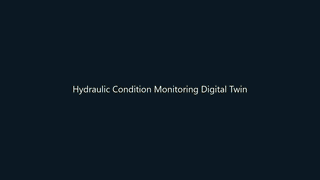
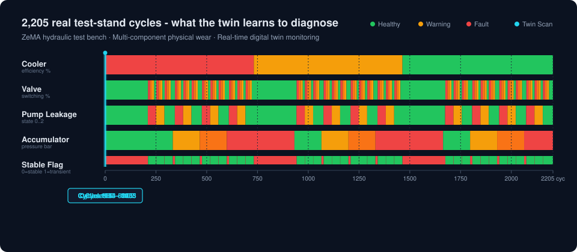

# Hydraulic Condition Monitoring Digital Twin (`hydro`)

<p align="center"></p>

A Level-2 read-only condition monitoring and diagnostic digital twin for the ZeMA hydraulic test stand (UCI 447, 2,205 cycles × 60 s).

## The problem and how we solved it (37 s)

<p align="center"><a href="docs/assets/explainer.mp4"></a></p>

Click for the full-quality MP4.

| Problem | What we built | Verified result |
| --- | --- | --- |
| Hydraulic wear in cooler, valve, pump, and accumulator is invisible until functional failure. | Multi-target CatBoost models combining statistical features with grey-box physics indicators (Walther viscosity, hydraulic capacitance, valve edge dynamics). | Under blocked folds, LDA is the strongest baseline on several targets (cooler 0.9823, valve 0.9977, pump 0.9915, accumulator 0.8019); hybrid CatBoost reaches 0.8792 cooler, 0.9764 valve, 0.9089 pump; CatBoost passes ONNX export parity (rtol 1e-5, atol 1e-6). |
| 17 sensor channels across three acquisition rates (100 Hz, 10 Hz, 1 Hz) generate too much raw data to monitor by eye. | Single-cycle feature extraction and ONNX inference deployed on an edge box over encrypted, read-only Level-2 OPC-UA. | CPU inference latency of 15.29 ms (p95), well within SLA < 150 ms; strictly read-only node access levels with no write path. |
| Unplanned downtime and lack of automated maintenance ticket triggering upon fault detection. | Online supervisory advisor calculating per-cycle Health Index (HI) with automated work order dispatch to ERPNext CMMS. | Degraded condition detected at HI ≈ 0.26 and recovery at HI ≈ 0.51 under online replay; 186+ passing tests and code health >= 9.6. |

## What It Does

- Diagnoses four component fault modes using multi-rate sensor telemetry:
  1. **Cooler condition**: full efficiency (100 %), reduced efficiency (20 %), or close to total failure (3 %).
  2. **Valve condition**: optimal switching (100 %), small lag (90 %), severe lag (80 %), or close to total failure (73 %).
  3. **Internal pump leakage**: no leakage (0), weak leakage (1), or severe leakage (2).
  4. **Hydraulic accumulator**: optimal pressure (130 bar), slightly reduced (115 bar), severely reduced (100 bar), or severely compromised (90 bar).
- Extracts statistical time-series features alongside grey-box hydraulic physics:
  - Walther oil viscosity equation (ASTM D341) for temperature-dependent fluid behavior.
  - Lumped hydraulic capacitance $C_{\mathrm{eff}}$ during pressure build-up.
  - Directional valve switching edge dynamics and inflection delays.
  - Causal heat exchanger thermal effectiveness over multi-cycle trailing windows.
- Evaluates multi-target classification under leakage-free blocked 5-fold cross-validation and temperature-shift distribution drift.
- Deploys as a read-only Level-2 OPC-UA service with real-time Health Index (HI) estimation and automated CMMS maintenance ticket dispatch.

## Hydraulic Circuit

<p align="center"></p>

## Architecture

<p align="center"></p>

The processing pipeline is organized into four distinct layers:
1. **Data Ingestion & Interim Store**: Validates raw sensor telemetry, verifies SHA-256 digest (TOFU), and stores partitioned interim Parquet files.
2. **Feature Extraction**: Computes statistical features (moments, energy, percentiles) and grey-box physics indicators (Walther viscosity, $C_{\mathrm{eff}}$, valve edge delays, thermal effectiveness).
3. **Model Pipelines & ONNX Export**: Trains classical classifiers (LDA, Random Forest, CatBoost) and a multi-rate 1D-CNN, with automated export and numerical parity validation against ONNX Runtime.
4. **Online Supervisory Advisor**: Replays cycles over an OPC-UA server with read-only node access levels, estimates component health indices, and dispatches maintenance work orders to ERPNext CMMS.

## Data

<p align="center"></p>

The dataset comprises 2,205 operating cycles of 60 seconds each, acquired on the ZeMA hydraulic test rig:
- **100 Hz Channels** (6,000 samples/cycle): `PS1`–`PS6` (hydraulic pressures), `EPS1` (motor electrical power).
- **10 Hz Channels** (600 samples/cycle): `FS1` (primary flow rate), `FS2` (secondary flow rate).
- **1 Hz Channels** (60 samples/cycle): `TS1`–`TS4` (fluid temperatures), `VS1` (vibration).
- **Virtual Channels** (`CE`, `CP`, `SE`): Excluded by default (`exclude_virtual=True`) to avoid target leakage.

### Animation Regeneration

To regenerate the animated SVG assets:

```bash
python scripts/make_readme_animation.py
```

To regenerate the explainer video, GIF, and WebP (scene images in `docs/assets/explainer/`, generated with Gemini image models in the style of a photoreal test-stand reference):

```bash
python scripts/make_explainer_video.py
```

## Verified Results

| Metric / Characteristic | Value | Specification / Standard |
| --- | --- | --- |
| Operating cycles | 2,205 | Full ZeMA UCI 447 run |
| Feature extraction + inference latency (CPU p50) | 13.89 ms | SLA < 150 ms |
| Feature extraction + inference latency (CPU p95) | 15.29 ms | SLA < 150 ms |
| Feature extraction + inference latency (CPU p99) | 15.97 ms | SLA < 150 ms |
| CatBoost ONNX export parity | Passes allclose | rtol 1e-5, atol 1e-6 (max rel error 1.82e-07) |
| 1D-CNN ONNX export parity | Validated (looser than plan target 1e-5) | rtol 1e-4, atol 1e-5 (max rel error ~3.3e-4) |
| Automated test suite | 186+ passing | Includes real-data heavy suite |
| Code health score (repowise code_shape) | >= 9.6 / 10 | Every repository source file |
| Online replay (cycles 2100–2105: valve 90, pump 2, acc 90) | HI ≈ 0.26 | Degraded condition detected |
| Online replay (valve 100 % restoration) | HI ≈ 0.51 | Partial recovery detected |

### Baseline Evaluation (Blocked 5-Fold)

From `reports/baseline_results.md`:

| pipeline | target | macro_f1 | macro_f1_all_labels | balanced_accuracy | fit_seconds |
| --- | --- | --- | --- | --- | --- |
| lda | cooler | 0.9823 | 0.9823 | 0.9823 | 0.7975 |
| lda | valve | 0.9977 | 0.9977 | 0.9977 | 0.7277 |
| lda | pump | 0.9915 | 0.9915 | 0.9917 | 0.7304 |
| lda | accumulator | 0.8019 | 0.8019 | 0.7981 | 0.7233 |
| rf | cooler | 0.7880 | 0.7880 | 0.7956 | 2.5896 |
| rf | valve | 0.9324 | 0.9324 | 0.9276 | 2.3430 |
| rf | pump | 0.8955 | 0.8955 | 0.8977 | 2.2938 |
| rf | accumulator | 0.1426 | 0.1426 | 0.1625 | 2.5306 |

### Four-Way Comparison (Blocked 5-Fold)

Training ran on an RTX 5070 Ti GPU (CatBoost task_type GPU, CNN on CUDA) with CPU-identical CatBoost hyperparameters.

From `reports/benchmark_results.md`:

| pipeline | target | macro_f1 | macro_f1_all_labels | balanced_accuracy | fit_seconds |
| --- | --- | --- | --- | --- | --- |
| statistical | cooler | 0.8487 | 0.8487 | 0.8507 | 21.3618 |
| statistical | valve | 0.9700 | 0.9700 | 0.9707 | 22.8830 |
| statistical | pump | 0.8854 | 0.8854 | 0.8895 | 20.8299 |
| statistical | accumulator | 0.3149 | 0.3149 | 0.3258 | 23.1180 |
| physics | cooler | 0.8185 | 0.8185 | 0.8293 | 16.6824 |
| physics | valve | 0.8462 | 0.8462 | 0.8815 | 16.9406 |
| physics | pump | 0.8112 | 0.8112 | 0.8002 | 17.0056 |
| physics | accumulator | 0.4221 | 0.4221 | 0.4373 | 18.1276 |
| hybrid | cooler | 0.8792 | 0.8792 | 0.8821 | 22.1368 |
| hybrid | valve | 0.9764 | 0.9764 | 0.9771 | 23.2573 |
| hybrid | pump | 0.9089 | 0.9089 | 0.9126 | 21.9153 |
| hybrid | accumulator | 0.3253 | 0.3253 | 0.3215 | 23.9561 |
| cnn_1d | cooler | 0.8756 | 0.8756 | 0.8785 | 9.1818 |
| cnn_1d | valve | 0.9972 | 0.9972 | 0.9963 | 9.1818 |
| cnn_1d | pump | 0.8856 | 0.8856 | 0.8858 | 9.1818 |
| cnn_1d | accumulator | 0.2127 | 0.2127 | 0.2103 | 9.1818 |

### Temperature-Shift Generalization

From `reports/benchmark_results.md`:

| pipeline | target | f1_in | f1_shift | f1_shift_all_labels | delta_f1 |
| --- | --- | --- | --- | --- | --- |
| statistical | cooler | 0.6579 | 0.2640 | 0.1760 | -0.3939 |
| statistical | valve | 0.9991 | 0.7853 | 0.7853 | -0.2138 |
| statistical | pump | 1.0000 | 0.6110 | 0.6110 | -0.3890 |
| statistical | accumulator | 0.2279 | 0.1303 | 0.1303 | -0.0976 |
| physics | cooler | 0.6533 | 0.2717 | 0.1811 | -0.3816 |
| physics | valve | 0.9725 | 0.7228 | 0.7228 | -0.2497 |
| physics | pump | 0.7937 | 0.4607 | 0.4607 | -0.3330 |
| physics | accumulator | 0.3970 | 0.2815 | 0.2815 | -0.1155 |
| hybrid | cooler | 0.6579 | 0.2624 | 0.1749 | -0.3955 |
| hybrid | valve | 1.0000 | 0.7228 | 0.7228 | -0.2772 |
| hybrid | pump | 1.0000 | 0.6110 | 0.6110 | -0.3890 |
| hybrid | accumulator | 0.3436 | 0.2741 | 0.2741 | -0.0695 |
| cnn_1d | cooler | 0.6567 | 0.2670 | 0.1780 | -0.3897 |
| cnn_1d | valve | 0.9871 | 0.5005 | 0.5005 | -0.4865 |
| cnn_1d | pump | 0.9644 | 0.5101 | 0.5101 | -0.4543 |
| cnn_1d | accumulator | 0.1463 | 0.0814 | 0.0814 | -0.0649 |

## Quick Start

### 1. Environment Setup

Requires Python 3.12:

```bash
python -m venv .venv
source .venv/bin/activate  # On Windows: .venv\Scripts\activate
pip install -e .[dev]
```

### 2. Ingest Dataset

Download, verify SHA-256 (TOFU), and partition raw data to Parquet:

```bash
python -m hydro ingest
# Or use the wrapper:
python scripts/run_ingest.py
```

### 3. Run Test Suite

Run unit and integration tests (synthetic fast fixtures finish in seconds):

```bash
pytest -q
```

### 4. Run Benchmark Evaluations

Run blocked 5-fold cross-validation baseline:

```bash
python -m hydro eval --config configs/data.yaml --split blocked --mode baseline-only
```

Run temperature-shift generalization benchmark:

```bash
python -m hydro eval --config configs/data.yaml --split temp-shift --mode full-comparison
# Or use the wrapper:
python scripts/run_benchmark.py
```

### 5. Profile Inference Latency

Measure feature extraction and ONNX runtime inference latency against SLA gates:

```bash
python scripts/profile_latency.py --cycles 10
```

### 6. Online Replay + Advisor

Train and export the online model bundle (last 205 cycles held out for replay), then replay held-out cycles over OPC-UA and run the read-only advisor on them:

```bash
python -m hydro bundle --out models/online
export HYDRO_OPCUA_USER=<user> HYDRO_OPCUA_PASSWORD=<password>   # local test credentials
python -m hydro.online.replay_server --start 2100 --cycles 6 --speed 5 &
python -m hydro.online.advisor_client --models-dir models/online --duration-sec 75
```

Application certificates are created automatically in `certs/` on first run (gitignored, valid 365 days). Both sides must share the `certs/` directory (same machine) so the advisor client can pin the server certificate.

For localhost testing without transport encryption, use the `--insecure` option:

```bash
python -m hydro.online.replay_server --insecure --start 2100 --cycles 6 --speed 5 &
python -m hydro.online.advisor_client --insecure --models-dir models/online --duration-sec 75
```

Verified 2026-10-20: cycles 2100-2105 (valve 90 %, pump 2, accumulator 90) give HI about 0.26; a cycle with valve back at 100 % gives HI 0.51.

## Repository Layout

```
hydraulic-condition-twin/
├── configs/
│   ├── data.yaml             # Dataset paths, TOFU digest, split configurations
│   ├── model.yaml            # Hyperparameters and random seeds
│   └── oil_vg46.yaml         # HLP 46 oil physical properties
├── reports/
│   ├── baseline_results.md   # Blocked 5-fold baseline evaluation metrics
│   ├── benchmark_results.md  # Four-way comparison and temperature-shift report
│   └── latency.md            # Inference latency percentiles (p50, p95, p99)
├── scripts/
│   ├── profile_latency.py    # Latency benchmarking and SLA gating
│   ├── run_benchmark.py      # Entry point for full benchmark evaluation
│   └── run_ingest.py         # Entry point for raw dataset download & interim export
├── src/hydro/
│   ├── cli.py                # Command line interface (ingest, eval, replay, bundle)
│   ├── data/                 # Download, loader, and channel schema registry
│   ├── eval/                 # Splits, metrics, reporting, and benchmark pipelines
│   ├── features/             # Statistical, Walther viscosity, and physics features
│   ├── models/               # Classical pipelines (LDA, RF, CatBoost), 1D-CNN, ONNX export
│   └── online/               # OPC-UA replay server, advisor client, and CMMS dispatcher
└── tests/                    # Unit, regression, security, and hardware mock tests
```

## Design Rules

- **Virtual Channels Excluded**: Calculated virtual channels (`CE`, `CP`, `SE`) are dropped by default (`exclude_virtual=True`) to prevent target leakage.
- **Blocked Cross-Validation**: Contiguous 5-fold time-ordered splits with zero temporal leakage across train and test partitions, plus fold class-coverage auditing.
- **Fold-Fitted Scalers and Baselines**: All transformations (e.g. `RobustScaler`, healthy valve inflection time reference $t_{\mathrm{baseline\_median}}$) are strictly fitted on training folds.
- **Causal Thermal Window**: Rolling multi-cycle thermal effectiveness features use a causal trailing window ($k - W + 1 \dots k$ with `min_periods=1`) to prevent future information leakage.
- **Read-Only OPC-UA**: All sensor nodes enforce `AccessLevel = UserAccessLevel = CurrentRead`. The server's custom user manager never grants the `Admin` role because `asyncua` Admin privileges bypass node `AccessLevel` restrictions.
- **Secure CMMS & OPC-UA Credentials**: Credentials and endpoints are configured strictly via environment variables (`ERPNEXT_URL`, `ERPNEXT_API_KEY`, `ERPNEXT_API_SECRET` for CMMS; `HYDRO_OPCUA_USER`, `HYDRO_OPCUA_PASSWORD` for OPC-UA). No secrets are stored in code or repository configuration files.

## Results

Detailed performance metrics and latency benchmarks are regenerated directly from data runs:
- Baseline evaluations (LDA, Random Forest): [reports/baseline_results.md](reports/baseline_results.md)
- Four-way comparison and temperature-shift generalization: [reports/benchmark_results.md](reports/benchmark_results.md)
- Single-cycle feature extraction and ONNX inference latency: [reports/latency.md](reports/latency.md)

## Limitations

- **Untested live CMMS**: ERPNext Issue doctype mapping is validated against local HTTP mocks and remains untested against a live production ERPNext server.
- **OPC-UA transport security**: OPC-UA uses Basic256Sha256 SignAndEncrypt with self-signed certificates; the server does not yet restrict client certificates to a trust list, so authentication relies on username/password; a plant deployment should use CA-issued certificates and a trust list.
- **Accumulator performance under blocked folds**: The hydraulic accumulator state is the weakest classification target for the tree and neural pipelines under blocked 5-fold cross-validation (LDA reaches 0.8019; Random Forest macro-F1 0.1426, Statistical CatBoost 0.3149, 1D-CNN 0.2127, Hybrid 0.3253, Physics 0.4221) due to severe fold imbalance and missing classes in test partitions.
- **Temperature-shift generalization hypothesis**: The hypothesis that grey-box physics features would resist performance degradation under thermal distribution drift was not confirmed by the data; all four pipelines experienced comparable F1 drops under temperature shift (e.g. cooler delta-F1 -0.3816 for physics vs -0.3939 for statistical).
- **CNN ONNX export parity**: While CatBoost passes allclose at rtol 1e-5 and atol 1e-6 (max relative error 1.82e-07), the 1D-CNN is validated at rtol 1e-4 and atol 1e-5 (max relative error about 3.3e-4 on near-zero outputs), looser than the plan target of 1e-5 (see `src/hydro/models/export.py`).
- **Laboratory test stand**: Sensor data originates from a controlled laboratory test bench (ZeMA) rather than an industrial field installation.
- **Identifiability of bulk modulus**: Effective fluid bulk modulus ($\beta_{\mathrm{eff}}$) is unidentifiable without geometric chamber volume measurements; only lumped capacitance $C_{\mathrm{eff}}$ is identified.
- **Artificially induced faults**: Faults were manually induced via valve settings and pre-charge changes rather than natural run-to-failure mechanical degradation.
- **Discrete fault states**: The dataset contains discrete fault state runs without continuous run-to-failure degradation trajectories.
- **Operating temperature band**: Oil temperatures remain within a 35–55 °C operating band, limiting extrapolation to extreme thermal regimes.
- **Single-cycle LMTD limitation**: True log mean temperature difference cannot be computed for a single cycle without secondary cooling circuit instrumentation.
- **Absence of solenoid timestamps**: Direct electrical switching signals are unavailable, necessitating pressure transient edge detection.
- **Online thermal window warm-up**: The online predictor buffers the last 5 cycles for the causal thermal effectiveness window; after start-up, a block gap or a server restart the buffer resets, so the next 4 cycles use a shorter window than training.

## Security

- **Read-only nodes**: All OPC-UA sensor nodes enforce `AccessLevel = UserAccessLevel = CurrentRead`. The server installs a custom user manager that never grants `Admin` privileges, rejecting write attempts with `BadNotWritable` or `BadUserAccessDenied`.
- **No write path in the advisor**: The supervisory advisor client is strictly passive, subscribing to telemetry frames without any write, method-call, or node-configuration capabilities.
- **Encrypted transport**: OPC-UA communication defaults to `Basic256Sha256` `SignAndEncrypt` using application certificates generated in `certs/` (or `--cert-dir`). The advisor client pins the server certificate on disk, and credentials are sent inside the encrypted channel.
- **Secrets from environment variables**: All credentials and sensitive endpoints (`HYDRO_OPCUA_USER`, `HYDRO_OPCUA_PASSWORD`, `ERPNEXT_URL`, `ERPNEXT_API_KEY`, `ERPNEXT_API_SECRET`) are loaded from environment variables. No secrets or private keys are stored in code or repository configuration files.

## License

Licensed under the GNU Affero General Public License v3.0 or later (AGPL-3.0-or-later). See [LICENSE](LICENSE). If you run a modified version as a network service, you must make its source code available to its users.
